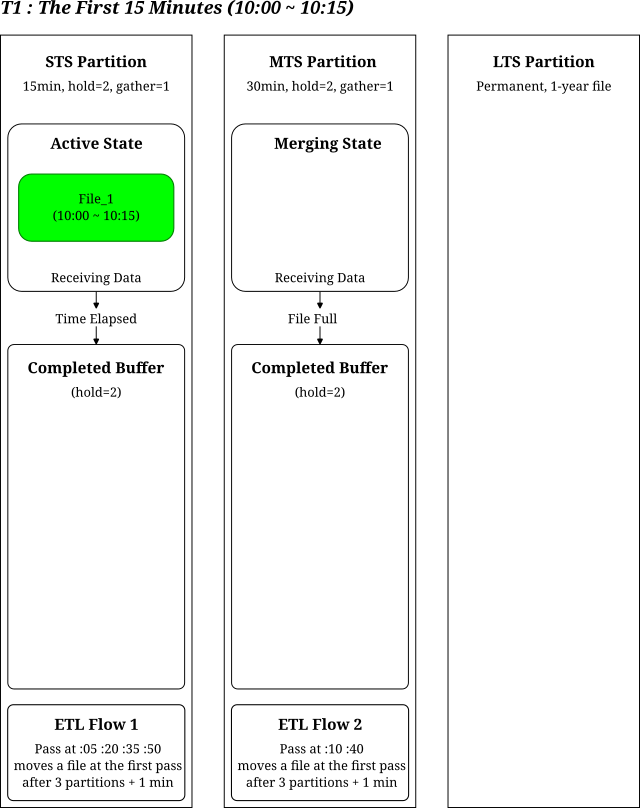
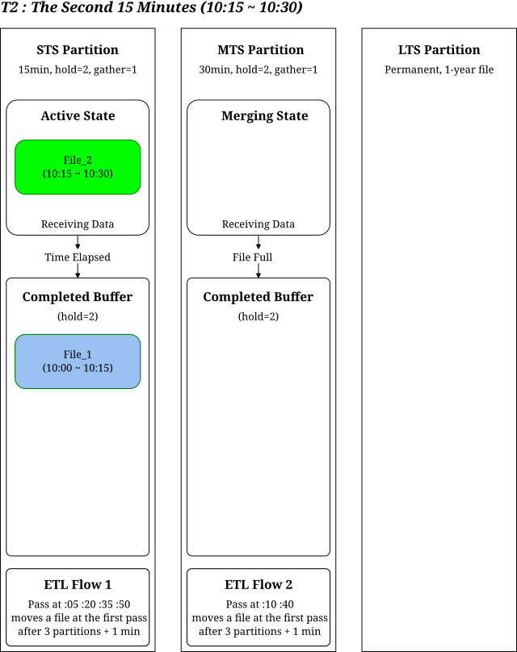
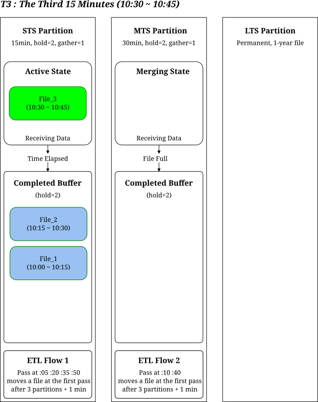
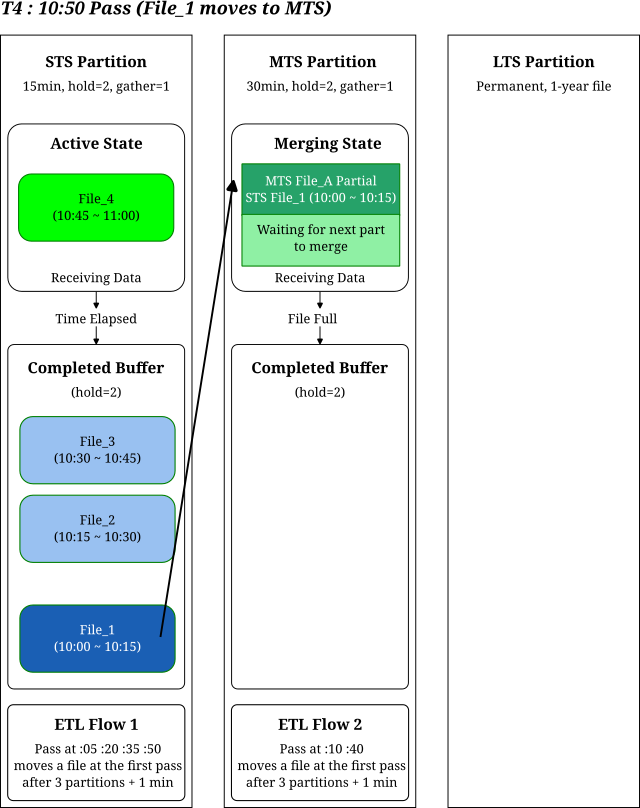
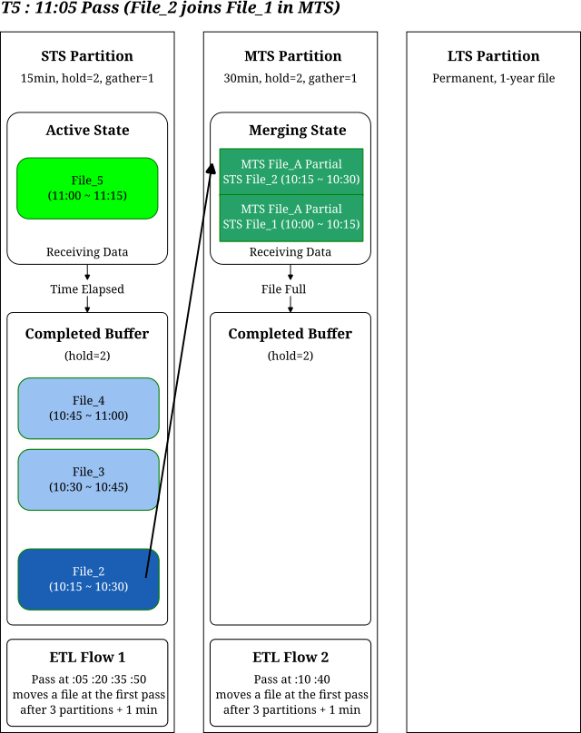
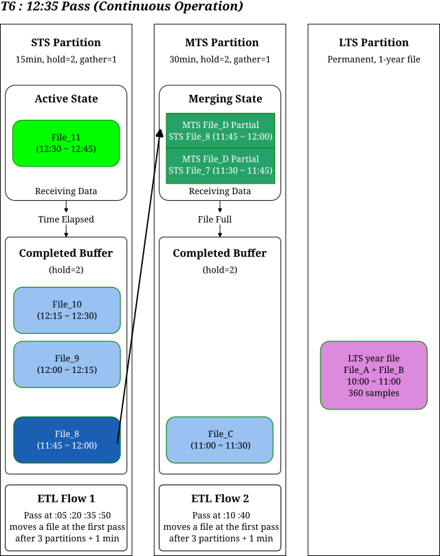

# The Data Journey in the EPICS Archiver Appliance

**Author:** Sangil Lee & Jeong Han Lee

This document explains when and how the ETL (the part of the appliance that moves archived data from one storage tier to the next) moves the data of one PV (Process Variable, a named data channel of the control system) from Short Term Storage (STS) to Middle Term Storage (MTS) and from MTS to Long Term Storage (LTS). It follows one scenario with exact times. The times, the file contents and the sample counts of the scenario come from a run of the real ETL pass scheduler, the real ETL job and the real storage plugins with a simulated clock (section 6).

## Executive Summary

The Archiver Appliance stores the data of a PV in three tiers. STS receives the samples, MTS receives the STS files and appends them into larger files, and LTS keeps the data permanently. The ETL moves data from one tier to the next in **passes**. A pass starts at fixed times, and in each pass the parameters `hold` and `gather` decide which files move.

The terms of this document:

* **Partition:** the time span that one file covers. The file is named after the start of its partition. `P` is the partition length of a tier.
* **Transition:** the move from one tier to the next: STS to MTS, and MTS to LTS.
* **Pass:** one run of the ETL jobs of the PVs that share a transition and a cadence. Passes start at fixed times (section 2).
* **Processing time `T_PROCESS`:** the time that a pass uses as its current time: the start of the pass minus 60 seconds.
* **`hold` and `gather`:** settings of a tier that decide which of its files a pass moves (section 3).
* **Hold boundary and gather boundary:** two times computed from `T_PROCESS` that the first samples of files are compared with (section 3, steps 2 and 3).
* **Move and append:** a move appends the samples of the source file to a file of the destination and then deletes the source file. Each source file that is appended to a destination file is one part of that file. A file arrives in a tier when its first sample, or its first part, is written to that tier.
* **Candidate and eligible:** a candidate is a file that a pass considers (section 3, step 1). An eligible candidate is a candidate that the pass moves: its first sample is at or before the gather boundary, and the oldest candidate that holds a sample has passed the hold boundary. With `hold=0` and `gather=0` every candidate that holds a sample is eligible, but a header-only candidate (a file that has a header but no sample) stops the job at that file (Files without samples).
* **Over and full:** a partition is over when its time span has ended. A file is full when it holds all samples of its partition. An STS file is full when its partition is over. An MTS file is full when its last part has arrived, which can be after its partition is over. An MTS file that lacks a part never becomes full and moves by the time rule (Fullness in section 3).

The two facts that answer most questions:

* **When:** with `gather=1` and fixed-length partitions (`PARTITION_5MIN` to `PARTITION_DAY`; otherwise use the steps of section 3), a file whose partition starts at time `S` moves in the first pass that starts at or after `S + (hold + 1) * P + 60 s`, where `P` is the partition length and `hold` the setting of the tier that the file leaves. A file that is eligible when it arrives in the source tier moves in the first pass after it arrives. The rule needs `hold` and `gather` above zero; for `hold=0` and `gather=0` see Defaults in section 3. The pass starts come from a fixed schedule (section 2), except the start-up pass after the ETL starts, a scheduled time that an overrun skips, and a pass that waits for a running pass of a lower-numbered transition.
* **How:** the destination appends the samples of the source file to its own file for the destination partition that contains them. Two 15-minute STS files are appended into one 30-minute MTS file, and the move deletes the source file. With `gather=1` and a destination partition that spans two source partitions, the data of the first file waits in the destination until the next file arrives.

## 1. Storage Tiers and File Units

The scenario uses the following settings. All times are UTC.

| Item | Value |
| :--- | :--- |
| STS partition | `PARTITION_15MIN`: one file holds 15 minutes |
| MTS partition | `PARTITION_30MIN`: one file holds 30 minutes |
| LTS partition | `PARTITION_YEAR`, the shipped value: one file holds one year |
| ETL rule | `hold=2`, `gather=1` on STS and MTS |
| Samples | one sample every 10 seconds, the first at 10:00:00 |

The data of a PV is stored in `.pb` files. Each file covers one partition of its tier and is named after the start of that partition in UTC, for example `ApplTest/AN/F/Analog10:2026_01_01_10_15.pb` for the 15-minute partition that starts at 10:15 on the date of the scenario, 2026-01-01. A full 15-minute STS file of the scenario holds 90 samples, a full 30-minute MTS file holds 180 samples, and the LTS file grows by the samples of every file that arrives.

Data moves through the following stages:

1.  **STS:** Designed for high-frequency writes, typically on fast media such as a RAM disk or an SSD. Files here are temporary and meant for ETL migration.
2.  **MTS:** An intermediate area that appends the smaller STS files into larger units. Files here are also temporary.
3.  **LTS:** The final destination of the data. Because the LTS partition is one year, the data that arrives in LTS is appended to one file for the year; it does not stay as separate files of 30 minutes.

### File States

* **Active:** The partition of the file contains the current time, and the file receives samples.
* **Completed:** An STS file is completed when its partition is over; an MTS file is completed when it is full (see Over and full in the Executive Summary).
* **Partial (MTS):** an MTS file that has received only some of its parts. The figures label such a file Partial; the box that holds it is the Merging State. A partial file is not completed. A partial file can be a candidate: a file is a candidate in a pass when its partition starts before the partition that contains the processing time of the pass (section 3).

## 2. When the ETL Runs

The ETL does not run at the moments when partitions end. Each transition between two tiers has a schedule of fixed pass start times.

* **Cadence:** the length of the source partition, at most 8 hours. STS of 15 minutes gives 900 s, MTS of 30 minutes gives 1800 s.
* **Offset:** 5 minutes times (transition number + 1). STS to MTS is transition 0 with offset 5 minutes. MTS to LTS is transition 1 with offset 10 minutes.
* **Schedule:** the pass start times are whole multiples of the cadence counted from the Unix epoch, plus the offset.
* **Start:** a pass starts at the first check (the scheduler checks every 5 seconds) at or after its scheduled time. A pass does not start while a pass of a lower-numbered transition is running; it starts at the first check after that pass ends.
* **Overrun:** when a pass ends after the next scheduled time of its transition, the scheduled times inside the pass are skipped, and the next pass starts at the first scheduled time after the pass ended.
* **PVs:** one pass runs the jobs of all PVs that use the same transition and cadence, one after another. Each pair of transition and cadence has its own driver, so PVs with different source partitions run in different passes.
* **Processing time:** every job of a pass uses the start time of the pass minus 60 seconds as its current time. The 60 seconds are a fixed margin of the scheduler. All boundaries in section 3 are computed from this time.
* **Start of the ETL:** each driver that holds at least one PV runs a start-up pass. The drivers of transition 0 start it at the first check after the ETL starts; a driver of a higher transition starts it at the first check at which no pass of a lower transition runs. A driver without PVs waits for its next scheduled time.

For the scenario this gives (the tables assume that a pass starts on its scheduled time; the real start is the first check, up to 5 seconds later):

| Transition | Cadence | Offset | Pass starts | Processing time |
| :--- | :--- | :--- | :--- | :--- |
| STS to MTS | 900 s | 5 min | hh:05, hh:20, hh:35, hh:50 | hh:04, hh:19, hh:34, hh:49 |
| MTS to LTS | 1800 s | 10 min | hh:10, hh:40 | hh:09, hh:39 |

The shipped policy (STS `PARTITION_HOUR`, MTS `PARTITION_DAY`, LTS `PARTITION_YEAR`, `hold=2` and `gather=1` on STS and MTS) gives:

| Transition | Cadence | Offset | Pass starts (UTC) |
| :--- | :--- | :--- | :--- |
| STS to MTS | 3600 s | 5 min | every hour at hh:05 |
| MTS to LTS | 28800 s (the 8-hour limit) | 10 min | 00:10, 08:10 and 16:10 |

## 3. What One Pass Moves: `hold` and `gather`

Let `P`, `hold` and `gather` be the settings of the tier that the files leave (STS for the move to MTS, MTS for the move to LTS), and `T_PROCESS` the processing time of the pass.

1. **Candidates:** the files of the PV whose partition starts before the partition that contains `T_PROCESS`, from the oldest to the newest.
2. **Hold boundary:** subtract `hold * P` from `T_PROCESS`, find the partition that contains the result, and take the last second of the partition before it. The oldest candidate that holds a sample must have its first sample at or before this boundary; a zero-byte or header-only candidate before it is skipped, and deleted when it is old (Files without samples). If the first sample of that candidate is later, nothing moves in this pass.
3. **Gather boundary:** compute a boundary in the same way with `hold - (gather - 1)` partitions instead of `hold`. Every candidate whose first sample is at or before this boundary moves. With `gather=1` both boundaries are the same, whatever the value of `hold`.
4. **Defaults:** `hold=0` and `gather=0` skip both boundaries, and every candidate that holds a sample moves. A header-only candidate breaks this: the job of the PV fails at that file, and no file of the pass is deleted from the source (Files without samples). Use nonnegative values with `hold >= gather`; equality is allowed.

**Closed form.** The closed form holds for `hold` and `gather` above zero; for `hold=0` and `gather=0` see Defaults below. For files whose first sample is at the start of their partition, as in the scenario, the rule says: a file with partition start `S` moves in the first pass with `T_PROCESS >= S + (hold - gather + 2) * P`, provided that the oldest candidate that holds a sample, with partition start `S_oldest`, satisfies `T_PROCESS >= S_oldest + (hold + 1) * P`. With `gather=1` this is `T_PROCESS >= S + (hold + 1) * P`, so the pass must start at or after `S + (hold + 1) * P + 60 s`. The formula is exact for tiers of a fixed partition length (`PARTITION_5MIN` to `PARTITION_DAY`). For `PARTITION_MONTH` and `PARTITION_YEAR` the subtraction uses 31 and 366 days and the partitions are calendar months and years, so use the steps above. With `PARTITION_MONTH` and `hold=1`, the file of February moves on 1 April, while the formula gives 4 April. A file that is eligible when it arrives in the source tier moves in the first pass that starts after it arrives. A file whose first sample lies inside its partition, up to the last whole second (for example 10:07:30 or 10:14:59.0), moves in the same pass as a file that starts at the partition start; it holds fewer samples. A first sample after the last whole second, such as 10:14:59.5, is later than the boundary, and the file moves one partition later.

**Worked example.** At the 10:50 pass, `T_PROCESS` is 10:49:00. Subtracting `2 * 15 min` gives 10:19:00. This lies in the partition 10:15 to 10:30, so the boundary is 10:14:59, the last second of the partition 10:00 to 10:15. The candidates are File_1 (10:00), File_2 (10:15) and File_3 (10:30). The partition of File_4 (10:45) contains `T_PROCESS`, so it is the active file. The first sample of File_1 is 10:00:00, which is at or before 10:14:59, so File_1 moves. The first sample of File_2 is 10:15:00, which is after the boundary, so File_2 stays. At the 10:35 pass `T_PROCESS` is 10:34:00, the boundary is 09:59:59, and File_1 (10:00:00) is after it, so nothing moves.

**Why `hold` waits.** Keeping the files of the newest `hold` partitions in the source tier lets retrievals of recent data read from the faster tier.

**How the destination receives the data.** The job appends the samples of the source file to the destination file of the partition that contains them. The destination file is created when the first part arrives and receives the next parts until it is full or moves to the next tier (Fullness). The source file is deleted after the destination has stored its samples, so during a move the file exists in both tiers.

**More than one file per pass.** `gather` sets the second boundary, which decides how many files move together. With `hold=2` and `gather=2`, File_1 and File_2 leave STS together at the 10:50 pass and the MTS file for 10:00 to 10:30 appears with 180 samples at once; the next move is File_3 and File_4 at 11:20, then every 30 minutes. With `gather=2` on STS only and `gather=1` on MTS, the MTS to LTS transition keeps moving one file at a time: the 10:00 file at 11:40 and the 10:30 file at 12:10. A pass that starts late can also select several files with `gather=1`, because every eligible candidate moves. A missing partition does not delay a move: the age of the oldest available data decides.

**Fullness.** The rule compares times only and does not check whether a file is full. A partial MTS file moves when its boundary is met, and the parts that arrive later form a new file for the same partition, which moves in a later pass. In the scenario and in the shipped policy an MTS file is full before its boundary is met.

**Defaults.** With `hold=0` and `gather=0`, each STS file moves in the first pass whose processing time `T_PROCESS` is at or after the end of its partition: File_1 at 10:20, File_2 at 10:35, and so on.

**Samples at the edges.** A partition includes its first second and excludes the instant at which the next partition starts: File_1 covers 10:00:00 up to, but not including, 10:15:00, so the sample stamped 10:15:00 belongs to File_2, and the last sample of File_1 is 10:14:50. In the simulated run, a sample stamped at the start of a pass is appended after the pass runs, so the active file at the 10:50 pass holds 30 samples (10:45:00 to 10:49:50). A real pass starts up to 5 seconds after its scheduled time, and its active file can also hold the sample stamped 10:50:00.

**Files without samples.** The plugin skips a zero-byte file and deletes it when its modification time in the file system is more than `hold + 1` partitions before the processing time `T_PROCESS`. A header-only file is skipped and deleted in the same way when `hold` or `gather` is above zero. With `hold=0` and `gather=0` the job of the PV fails with a `NullPointerException` at that file: the candidates before it are appended to the destination, the candidates after it are not processed, and no file of the pass is deleted from the source.

### Where the Settings Come From

The shipped `policies.py` is rendered from `site-template/policies.py.in`. It sets the partition and the `hold` of each tier from the Make variables `ARCHAPPL_STS_GRANULARITY`, `ARCHAPPL_STS_HOLD`, `ARCHAPPL_MTS_GRANULARITY`, `ARCHAPPL_MTS_HOLD` and `ARCHAPPL_LTS_GRANULARITY`; see [Store settings as build variables](README.policies.md#55-store-settings-as-build-variables). The template fixes `gather=1` on STS and MTS and accepts only positive integers for `hold`. A value such as `gather=2`, or the defaults `hold=0` and `gather=0`, needs an edit of the template `site-template/policies.py.in`. `make conf` renders `site-template/policies.py` from the template, and `make install` copies that file over the installed `policies.py`. An edit of the template takes effect after `make conf`, and an edit of the installed file is lost at the next `make install`.

A changed template or Make variable reaches only the PVs that are archived after the change. When a PV is archived, its store URLs with their `hold` and `gather` are written to the type information of the PV, and the ETL builds the source and the destination of each transition from those URLs. A PV that was archived before the change keeps its stored URLs after `policies.py` changes (section 6).

## 4. Timeline Scenario: A Day in the Life of Data

The scenario starts with the first sample at 10:00:00. The ETL runs before that, so its passes follow the schedule of section 2. The table shows the first partition changes and then every pass up to 13:10 that moves data. In every other pass up to 13:10 the files stay where they are, because no candidate is eligible or no candidate exists: 10:05, 10:10, 10:20, 10:35, 10:40 and 11:10 are examples.

|Time|Pass|What moves|STS after the pass|MTS after the pass|LTS after the pass|
| :--- | :--- | :--- | :--- | :--- | :--- |
|10:00| |The first sample arrives|File_1 (10:00) active| | |
|10:15| |File_1 is completed with 90 samples; File_2 starts|File_1 completed; File_2 active| | |
|10:30| |File_2 is completed with 90 samples; File_3 starts|File_1, File_2 completed; File_3 active| | |
|10:45| |File_3 is completed with 90 samples; File_4 starts|File_1, File_2, File_3 completed; File_4 active| | |
|10:50|STS to MTS|File_1 moves|File_2, File_3 completed; File_4 active|10:00 file, 90 samples| |
|11:05|STS to MTS|File_2 moves|File_3, File_4 completed; File_5 active|10:00 file full, 180 samples| |
|11:20|STS to MTS|File_3 moves|File_4, File_5 completed; File_6 active|10:00 file; 10:30 file, 90 samples| |
|11:35|STS to MTS|File_4 moves|File_5, File_6 completed; File_7 active|10:00 file; 10:30 file full, 180 samples| |
|11:40|MTS to LTS|The 10:00 file moves|File_5, File_6 completed; File_7 active|10:30 file|180 samples (10:00 to 10:30)|
|11:50|STS to MTS|File_5 moves|File_6, File_7 completed; File_8 active|10:30 file; 11:00 file, 90 samples|180|
|12:05|STS to MTS|File_6 moves|File_7, File_8 completed; File_9 active|10:30 file; 11:00 file full|180|
|12:10|MTS to LTS|The 10:30 file moves|File_7, File_8 completed; File_9 active|11:00 file|360 (10:00 to 11:00)|
|12:20|STS to MTS|File_7 moves|File_8, File_9 completed; File_10 active|11:00 file; 11:30 file, 90 samples|360|
|12:35|STS to MTS|File_8 moves|File_9, File_10 completed; File_11 active|11:00 file; 11:30 file full|360|
|12:40|MTS to LTS|The 11:00 file moves|File_9, File_10 completed; File_11 active|11:30 file|540 (10:00 to 11:30)|
|12:50|STS to MTS|File_9 moves|File_10, File_11 completed; File_12 active|11:30 file; 12:00 file, 90 samples|540|
|13:05|STS to MTS|File_10 moves|File_11, File_12 completed; File_13 active|11:30 file; 12:00 file full|540|
|13:10|MTS to LTS|The 11:30 file moves|File_11, File_12 completed; File_13 active|12:00 file|720 (10:00 to 12:00)|

The table shows the state after each event. Between two events the partitions roll over: at 12:00 File_8 is completed and File_9 starts, so the state at 12:00 is the row of 11:50 with File_8 completed and File_9 active.

File_n is the STS file that starts at 10:00 plus (n - 1) times 15 minutes, so File_11 starts at 12:30 and File_13 at 13:00.

The durations follow from the table and the rule of section 3. They are ages counted from the start of the partition, not the time that a file spends in the tier:

* With `gather=1` and `hold` above zero, a file leaves its tier in the first pass that starts at or after `(hold + 1) * P + 60 s` after its partition began. When the partition has a fixed length (`PARTITION_5MIN` to `PARTITION_DAY`), the cadence divides it, and the offset is smaller than the cadence, the pass schedule is aligned to the partition starts, and the age at which the file leaves is `(hold + 1) * P` plus the offset of the transition (5 minutes times (transition number + 1)).
* In the scenario an STS file leaves STS 50 minutes after its partition starts: 45 minutes plus the offset of 5 minutes. An MTS file leaves MTS 100 minutes after its partition starts: 90 minutes plus the offset of 10 minutes. The 10:00 file is full at 11:05 and leaves at 11:40.
* The time in a tier is shorter: the two parts of the 10:00 MTS file arrive at 10:50 and 11:05 and leave together at 11:40, after 50 and 35 minutes.
* With the shipped policy (STS one hour, MTS one day, `hold=2`), an STS file that starts at 10:00 leaves at 13:05 (3 hours plus 5 minutes), and the MTS file of a day leaves at 00:10 UTC, three days after that day begins (3 days plus 10 minutes).

### Reading the Figures

Each figure shows one tier in each column.

* **Active State** (STS) and **Merging State** (MTS) hold the file that receives data. In MTS this is the file of the 30-minute partition that receives the arriving STS files as appended parts; the long black arrow from the STS Completed Buffer to the MTS box is the move and append of section 3, and the small arrow labeled **File Full** inside the MTS column shows the full MTS file moving to its Completed Buffer.
* **Completed Buffer** holds the files that wait for a pass: in STS the files whose partition is over, in MTS the full files. An MTS file that is not full yet is in the Merging State. The label `(hold=2)` names the setting. In the STS of the scenario the buffer holds three files just before a move and two after it; in the MTS it holds two and one. The MTS count is smaller because each MTS file receives its parts 50 and 65 minutes after its partition starts: at 11:40 the file of 11:00 to 11:30 is not in MTS yet. Figure 6 is drawn in the middle of the 12:35 pass, before File_D is full, so its MTS buffer shows only File_C, the MTS file of 11:00 to 11:30. The dark blue file is the one that the pass moves.
* **Time Elapsed** is the arrow from the active box to the completed buffer: a file goes there when its partition is over. **Receiving Data** is the fixed label of an active box, also when the box is empty. **ETL Flow 1** and **ETL Flow 2** give the pass times of the transition and the age at which a file moves: the first pass at least `hold + 1` partitions and 1 minute after the start of its partition.
* The titles of the columns ("STS Partition", "MTS Partition", "LTS Partition") name the tier; the word partition there is not the time span of the terms list. The subtitle of an STS or MTS column gives the partition length, `hold` and `gather` of the tier; the subtitle of the LTS column names its one-year file.
* Colors: green is the active file, light blue a completed file, dark blue the file that the pass moves, teal an MTS file that receives parts, light green the part that has not arrived, and purple data in LTS. **Partial** names an MTS file that has not received all its parts when the pass starts; in Figures 5 and 6 the file is drawn with both parts because the pass makes it full. The purple box of Figure 6 shows the range of data inside the one LTS year file; it is not a partition.
* Figures 4 to 6 draw a pass in progress: the moving file is drawn in its source tier and, joined by the arrow, in its destination.
* File_1, File_2, and so on are the STS files. File_A, File_B, File_C and File_D are the MTS files of 10:00-10:30, 10:30-11:00, 11:00-11:30 and 11:30-12:00. LTS holds one file for the year.

### [T1] 10:00:00 - 10:15:00 (The First 15 Minutes)
* **STS:** The first file, `File_1 (10:00-10:15)`, is created. Data is actively being written to it (Active State).
* **Passes:** The 10:05 pass finds no candidate: File_1 is the active file.

||
| :---: |
|**Figure 1** T1, The First 15 Minutes|

### [T2] 10:15:00 - 10:30:00 (The Second 15 Minutes)
* **STS:** `File_1` is completed and waits. `File_2 (10:15-10:30)` begins writing.
* **Passes:** At the 10:20 pass, `T_PROCESS` is 10:19:00 and the boundary is 09:44:59. The first sample of File_1 is 10:00:00, which is after the boundary, so File_1 is not eligible.

||
| :---: |
|**Figure 2** T2, The Second 15 Minutes|

### [T3] 10:30:00 - 10:45:00 (The Third 15 Minutes)
* **STS:** `File_2` is completed. Two files are completed, `File_1` and `File_2`, and `File_3 (10:30-10:45)` begins writing.
* **Passes:** At the 10:35 pass, `T_PROCESS` is 10:34:00 and the boundary is 09:59:59. The first sample of File_1 is 10:00:00, which is after the boundary, so File_1 is not eligible.

||
| :---: |
|**Figure 3** T3, The Third 15 Minutes|

### [T4] 10:50 (The STS to MTS Pass That Moves File_1)
* **STS:** `File_3` completed at 10:45, and `File_4 (10:45-11:00)` is the active file. Three files are completed: `File_1`, `File_2` and `File_3`.
* **Trigger:** At the 10:50 pass, `T_PROCESS` is 10:49:00 and the boundary is 10:14:59. The first sample of `File_1` is at or before it.
* **Action:** `File_1 (10:00-10:15)` moves to MTS. The first sample of `File_2` is 10:15:00, and File_2 remains in STS. After the pass two files are completed: with `gather=1`, `hold` completed files remain.
* **MTS:** `File_1` arrives and creates the file for the partition `10:00-10:30` with 90 samples. The file waits for the second half.

||
| :---: |
|**Figure 4** T4, The 10:50 Pass|

### [T5] 11:05 (The Pass That Fills the First MTS File)
* **STS:** At the 11:05 pass, `T_PROCESS` is 11:04:00 and the boundary is 10:29:59, so `File_2 (10:15-10:30)` is eligible. `File_5 (11:00-11:15)` is active.
* **MTS:** `File_2` is appended to the waiting `File_1`. The file for `10:00-10:30` holds 180 samples and is full.
* **LTS:** The MTS file has to wait: at the 11:10 pass, `T_PROCESS` is 11:09:00 and the MTS boundary is 09:59:59, so its first sample at 10:00 is not eligible. It moves at 11:40, the first pass with `T_PROCESS` of 11:30 or later.

||
| :---: |
|**Figure 5** T5, The 11:05 Pass|

### [T6] 12:35 (Continuous Operation)

After a longer period, the system reaches a steady state: every 15 minutes an STS file leaves STS, every 30 minutes MTS receives the last part of a file, and every 30 minutes the oldest MTS file moves to LTS. The figure shows the 12:35 pass.

* **STS:** `File_11 (12:30-12:45)` is receiving data, while `File_10`, `File_9` and `File_8` wait as completed files. `File_8 (11:45-12:00)` is the one the pass moves out.
* **MTS:** `File_D (11:30-12:00)` receives `File_7`, which arrived at 12:20, and `File_8`, which arrives in this pass. `File_C (11:00-11:30)` is full and waits for the MTS to LTS pass at 12:40.
* **LTS:** The data of `File_A (10:00-10:30)` and `File_B (10:30-11:00)` is in the LTS file, which holds 360 samples. `File_C` joins at 12:40 and `File_D` at 13:10.

||
| :---: |
|**Figure 6** T6, The 12:35 Pass|

## 5. Reading the Numbers

* **`hold`:** how many further partitions of the source tier must elapse after a file's own partition. With `gather=1`, a file can leave when `hold + 1` partition lengths have passed since its partition began; with a larger `gather`, the files after the oldest leave earlier (Closed form in section 3). With `gather=1`, `hold` completed files remain in the STS of the scenario after a pass that moved a file; with a larger `gather`, `hold - gather + 1` remain. In the MTS of the scenario one full file remains after a pass of MTS to LTS, because the file of the next partition has not arrived yet; the count in a tier depends on when the parts arrive, so it is not `hold` in general. The rule counts time, not the number of files in the source tier.
* **`gather`:** sets the boundary for the files that move after the oldest candidate that holds a sample has satisfied `hold`. Every candidate at or before the gather boundary moves; in the scenario, a pass on the regular schedule that moves files moves `gather` files, and a late pass can move more (More than one file per pass in section 3). With `gather=2` in the scenario, a move happens every second pass.
* **Boundary times such as 10:14:59:** the hold boundary is the last second of the partition that precedes the partition containing `T_PROCESS - hold * P` (section 3, step 2); section 3, step 3 gives the gather boundary. A candidate moves when its first sample is at or before the gather boundary and the oldest candidate that holds a sample has passed the hold boundary.
* **Processing time `T_PROCESS`:** the start of the pass minus 60 seconds. Every boundary is computed from `T_PROCESS`, not from the start time of the pass.
* **Sample counts such as 90 and 180:** one sample every 10 seconds gives 6 samples per minute, 90 samples in 15 minutes and 180 samples in 30 minutes. In the scenario, a file with a smaller count is receiving data or waits for its second half. A real PV has a count that depends on its event rate; only the times of its first and last sample follow the rules above.
* **Disk planning:** the document counts samples, not bytes; multiply the sample counts by the size of one sample of the PV. For the shipped policy a PV has, just before the STS to MTS pass at hh:05, three completed hour files and the active file in STS (3 hours 5 minutes of samples). Just before the MTS to LTS pass at 00:10 it has three day files in MTS: two full files and a partial file of 22 hours, because the last two hours of that day reach MTS at 01:05 and 02:05 on the next day. The file that is being moved exists in both tiers during the move.
* **When a file reaches MTS:** ask three questions in this order. First, is the partition of the file over? Second, for `hold` and `gather` above zero and fixed-length partitions (`PARTITION_5MIN` to `PARTITION_DAY`; otherwise use the steps of section 3) the pass must start at or after `S + (hold - gather + 2) * P + 60 s`, where `S` is the start of the file; with `gather=1` this is `S + (hold + 1) * P + 60 s`. The oldest candidate that holds a sample must satisfy `T_PROCESS >= S_oldest + (hold + 1) * P` too; otherwise nothing moves in the pass. Third, the move happens in the first scheduled pass at or after that time; the passes of STS to MTS start only at the times of section 2, except the start-up pass after the ETL starts, a time that an overrun skips, and a pass that waits for a running pass of a lower-numbered transition. For the shipped policy the data of the hour that starts at 10:00 reaches MTS at 13:05 UTC.

## 6. Runs That Verify the Scenario

Every statement about the moves of files and the schedule of passes comes from a run of the ETL code of the source repository (commit `65245250`), except the points named at the end of this section. The runs use the real `PBThreeTierETLPVLookup`, `ETLPassTicker` and `ETLPassDriver` for the schedule, the real `ETLJob` for the moves, and the real `PlainPBStoragePlugin` for STS, MTS and LTS. The runs on this host simulate only the clock; the run on the guest uses the real clock. A test writer stands in for the engine and appends one sample at a time through the real plugin. File modification times are real. The ticker advances in steps of 5 seconds, unless a run says otherwise, and the content of the stores is read after every pass.

* **The scenario** (STS `PARTITION_15MIN`, MTS `PARTITION_30MIN`, `hold=2`, `gather=1`, one sample every 10 seconds) gives the table of section 4, the boundaries of the worked example and the per-time text.
* **Every combination of `hold` from 0 to 3 and `gather` from 0 to `hold`,** on STS and on MTS, over eight hours, gives the steps and the closed form of section 3 and the Defaults.
* **`hold` and `gather` of 4 and 2, 5 and 1, 5 and 3, 5 and 5, and 6 and 3,** over sixteen hours, give the count of completed files that remain in STS after a pass, `hold - gather + 1`.
* **`gather=2` on STS only and `gather=1` on MTS** gives the MTS to LTS times of More than one file per pass.
* **The shipped partitions** (`PARTITION_HOUR`, `PARTITION_DAY`, `PARTITION_YEAR`) over four days give the shipped moves and the numbers of section 5. A run of three days with the same partitions gives the shipped pass starts: hh:05 for STS to MTS, and 00:10, 08:10 and 16:10 for MTS to LTS.
* **STS `PARTITION_5MIN` with MTS `PARTITION_15MIN`, both of `PARTITION_5MIN`, `PARTITION_MONTH` with `PARTITION_YEAR` for `hold` 1 and 2 (checks every 60 seconds), and both of `PARTITION_YEAR` (checks every 300 seconds)** give the durations of section 4 and the limits of the closed form.
* **STS `PARTITION_DAY` with MTS `PARTITION_MONTH`, and samples at irregular times,** give the same results as the steps of section 3; only the time of the first sample of a file counts.
* **STS `PARTITION_5MIN` with `hold=10` and MTS `PARTITION_30MIN` with `hold=1`** gives the move of a partial MTS file in Fullness.
* **An ETL start at 11:03:17 over data written before the start** gives the start-up pass.
* **The real ticker thread, with a clock that runs 30 times faster than the wall clock,** gives the check every 5 seconds: the passes start 5.0 seconds apart. A driver of transition 1 starts its start-up pass at the first check at which no pass of transition 0 starts.
* **A clock that reads 20 minutes later at the end of every pass** gives the Overrun rule. **250000 PVs with a clock that runs 60 times faster** give it again with passes of about 1.2 to 1.4 seconds of wall time that cross a scheduled time: that time is skipped and the next pass starts at the first scheduled time after the pass ended.
* **A PV with two stores and a PV whose ETL jobs are deleted** give the rule that a start-up pass runs only for a driver that holds a PV.
* **Three PVs, two with STS `PARTITION_15MIN` and one with STS `PARTITION_HOUR`,** give one driver for each pair of transition and cadence, one pass for the PVs of the same pair, and the order of the start-up passes.
* **The real `ETLJob` over real PlainPB stores** runs a zero-byte file and a header-only file, each with an old and a recent modification time, with `hold=0` and `gather=0` and with `hold=2` and `gather=1`. It runs files whose first sample is at 10:00:00, 10:07:30, 10:14:59.0 and 10:14:59.5. It runs a zero-byte file whose modification time is 1 second inside, exactly at and 1 second beyond the limit of `hold + 1` partitions. It runs a zero-byte and a header-only file as the oldest candidate, and stores where older partitions, or a partition between two others, are missing. These runs give Files without samples, Defaults, the hold check on the oldest candidate that holds a sample, the first-sample sentence of the closed form and the sentence on a missing partition.
* **The real driver with two PVs on one pass,** one of them with a header-only file and `hold=0`, `gather=0`, gives that the failed job of one PV does not stop the job of the other PV.
* **A read of each store after the scenario to 12:36** gives that the data of the newest `hold` partitions can be read from STS alone: 216 samples for 12:00 to 12:36, and none of them in MTS or LTS.
* **The real policy engine with two `policies.py` files** that differ only in the MTS `hold` (2 and 7) and the real ETL lookup give Where the Settings Come From: the PV archived under the first file keeps `hold=2` in its ETL source after the file is replaced by the second, and a PV archived afterwards gets `hold=7`. One run keeps the type information of the PV in the in-memory store of the test service, and one run keeps it in a real SQLite database that a new persistence object reads after the change.
* **A fresh Debian 13 guest with MariaDB over a local socket and the installed appliance** (the case `debian13-socket` of the VM driver, environment commit `1461cfa`, source commit `65245250`, checks T3 to T12 passed) ran for 70 minutes with the real clock, `PARTITION_5MIN` for STS (`hold=2`, `gather=1`) and for MTS (`hold=1`, `gather=1`). Eleven files of STS left STS, each at the scheduled time 20 minutes after the start of its partition, at most 1 second late, and each MTS file left 5 seconds after it. After a pass two completed files remained in STS. A PV archived before `hold` of STS changed from 2 to 4 in `policies.py` kept `hold=2` in its row of the MariaDB table, and a PV archived after the change got `hold=4`.
* **`make` in a copy of the repository with the install path set to a scratch folder** gives the rest of Where the Settings Come From: `ARCHAPPL_STS_HOLD` of 0, -1 and `abc` stops the rendering with the message that it must be a positive integer, the template carries `gather=1` for STS and MTS, an edit of the template reaches the installed `policies.py` only after `make conf.policies` (a step of `make conf`), and `make policies.install` overwrites an edit of the installed file.

Not run: a complete appliance with the shipped partitions (`PARTITION_HOUR` and `PARTITION_DAY`) over days; the shipped schedule comes from the run of the real classes under a simulated clock, and `make install` ran as a whole only on the guest of the VM driver.

For the scheduler design, see `docs/design-etl-pass-scheduler.md` in the source repository. For the policy parameters, see [ETL flow control](README.policies.md#23-etl-flow-control).
